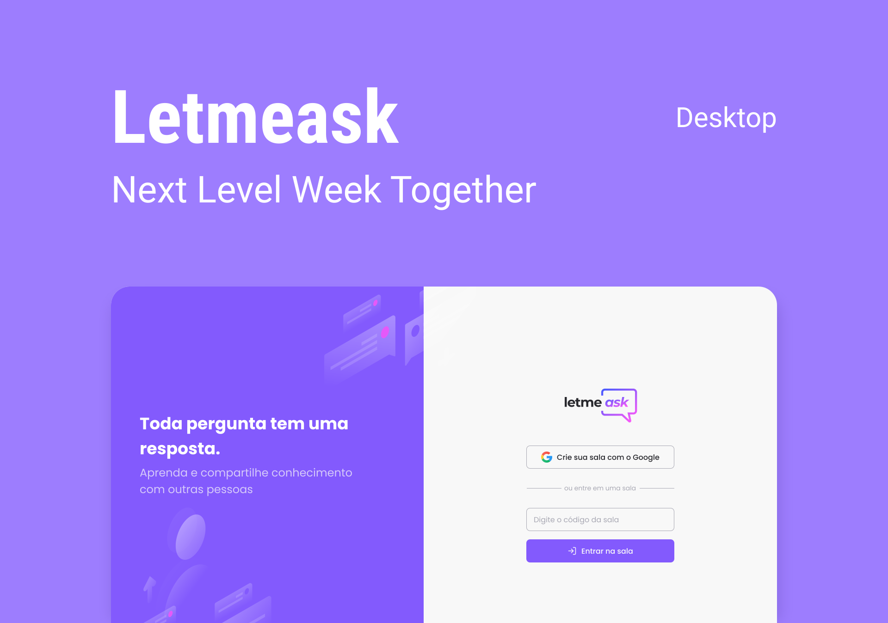

<p align="center">
  
</p>

<p align="center">
  
  
  <a href="https://rafaelfachinelli.com">
    
  </a>
  
</p>

<p align="center">
  <a href="#eye_speech_bubble-preview">Preview</a> •
  <a href="#information_source-about">About</a> •
  <a href="#memo-tasks">Tasks</a> •
  <a href="#arrow_forward-run">Run</a> •
  <a href="#hammer_and_wrench-technologies">Technologies</a> •
  <a href="#boy-author">Author</a> •
  <a href="#balance_scale-license">License</a>
</p>

---

## :eye_speech_bubble: Preview

<div align="center">



</div>

---

## :information_source: About

🗣 Live Q&A rooms for streams and events. Sign in with Google, create a room and share its code; the audience sends questions and likes them in real time, and the room admin can highlight a question, mark it as answered, delete it or close the room.

Built in 2021 during Rocketseat's Next Level Week #6 Together, with Firebase Authentication and Realtime Database.

---

## :memo: Tasks

<div align="center">
<details>
<summary>Click to view</summary>

|State|Task|
|:---:|:---|
|:heavy_check_mark:|Sign in with Google (Firebase Authentication)|
|:heavy_check_mark:|Create a room and join one by code|
|:heavy_check_mark:|Send questions in real time|
|:heavy_check_mark:|Like questions|
|:heavy_check_mark:|Admin room: highlight, mark as answered and delete questions|
|:heavy_check_mark:|Close the room|
|:heavy_check_mark:|Auth context and useAuth / useRoom hooks|
|:heavy_check_mark:|Realtime Database security rules|

</details>
</div>

---

## :arrow_forward: Run

You need [Node.js](https://nodejs.org/), [Yarn](https://yarnpkg.com/) and a [Firebase](https://firebase.google.com/) project with Google sign-in and Realtime Database enabled.

```bash
# Create the environment file and fill in your Firebase keys
cp .env.example .env.local

# Install dependencies
yarn

# Start the development server
yarn start
```

> The app opens at <http://localhost:3000>.

---

## :hammer_and_wrench: Technologies

<div align="center">

|Web|Backend as a service|
|:---:|:---:|
|[React](https://react.dev/)|[Firebase Authentication](https://firebase.google.com/products/auth)|
|[TypeScript](https://www.typescriptlang.org/)|[Firebase Realtime Database](https://firebase.google.com/products/realtime-database)|
|[React Router](https://reactrouter.com/)|[Firebase Hosting](https://firebase.google.com/products/hosting)|
|[Sass](https://sass-lang.com/)||
|[classnames](https://github.com/JedWatson/classnames)||

</div>

---

## :boy: Author

<div align="center">

<a href="https://rafaelfachinelli.com">
  
  <br/>
  <sub><b>Rafael Fachinelli</b></sub>
</a>

Tech Lead and software engineer. Get in touch!

[](https://rafaelfachinelli.com)
[](https://www.linkedin.com/in/rafaelfachinelli/)
[](https://github.com/rafaelfachinelli)
[](mailto:contato@rafaelfachinelli.com)

</div>

---

## :balance_scale: License

This project is under the [MIT license](./LICENSE).
